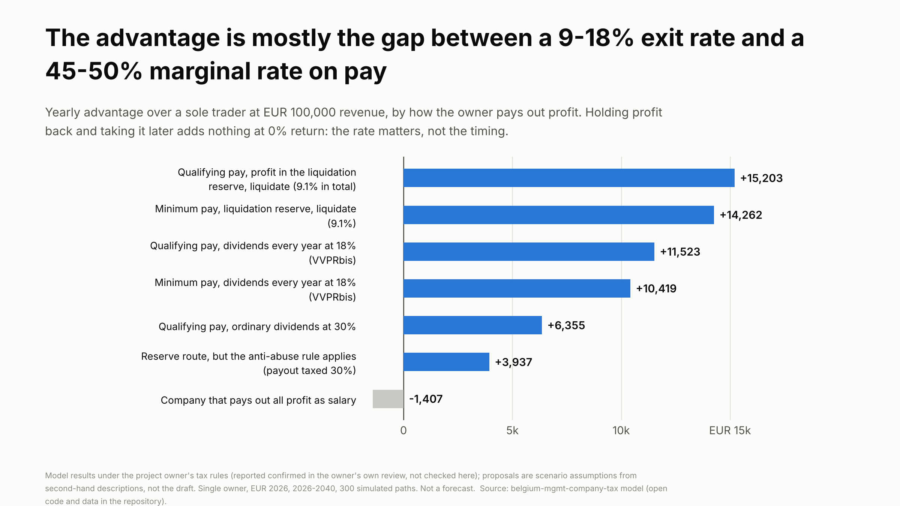
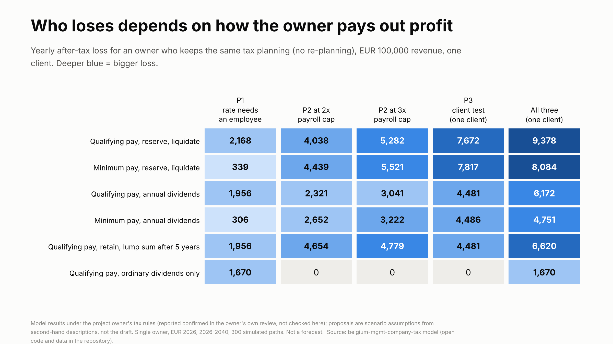
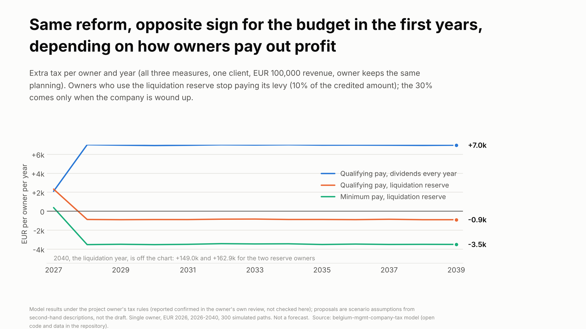
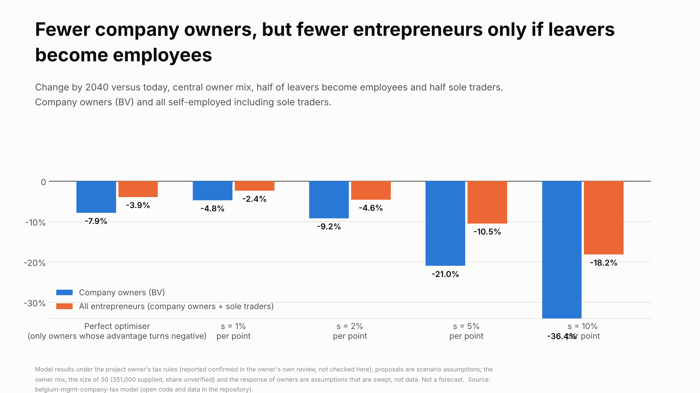
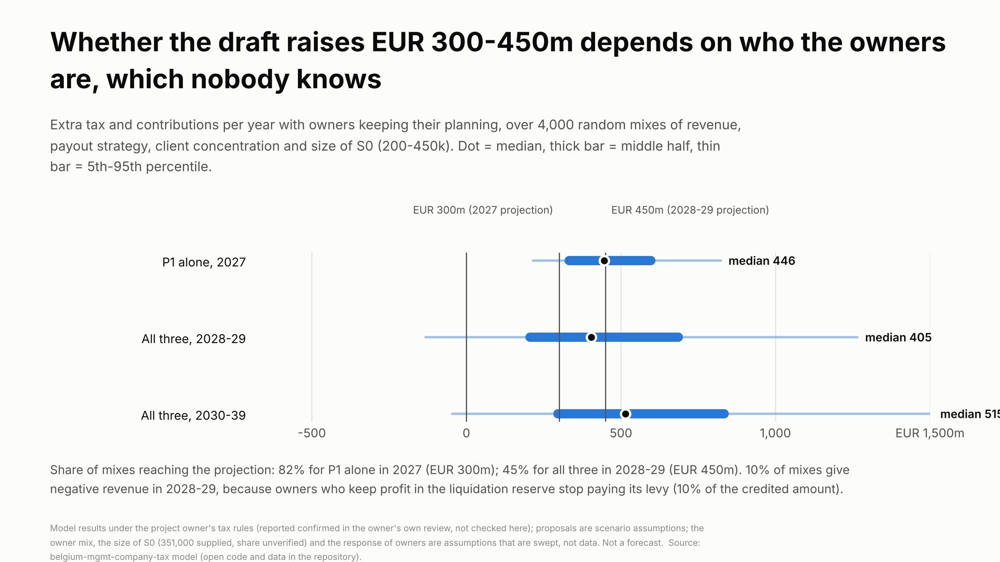
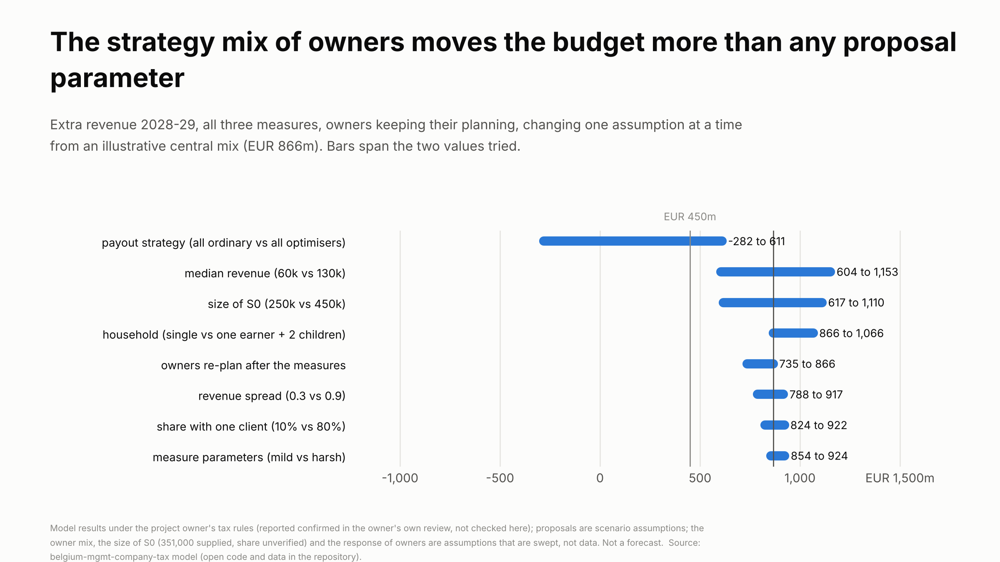
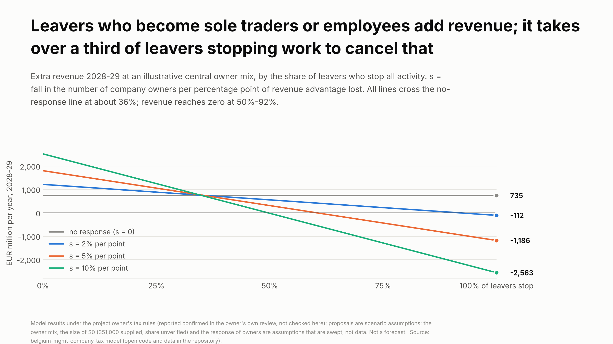

# Will the Belgian draft on management companies reduce entrepreneurs, change the wealth distribution and improve the budget?

**A modelling report on one-person companies (BV/SRL): motivation, method, data and results (15 November 2026).**

> **How to read this report.** Everything below is a *model* result. (1) The tax rules were supplied by the project owner and, in the owner's own checklist review of 15 November 2026, **reported confirmed against primary sources** (this analysis could not open those pages itself: anti-bot blocks and a 404), and three readings were corrected by that review; so every figure is conditional on those rules, and what still needs a look is in [`hand_check_list.md`](hand_check_list.md). (2) The draft text was not available: P2 (payroll multiple 2x/3x) and P3 (client threshold, lookback) come from second-hand excerpts and are run as **scenario assumptions**, never as 'the proposal'. (3) The population-level results (section 5.4) are **bounds and sweeps**, not estimates: the mix of owner types in S0, its size, and how owners respond are assumptions that no data identify, so every such result is conditional on them. (4) Nothing here is a forecast of what owners will do. Every hypothesis and its verdict is in [`hypotheses.md`](hypotheses.md).

## 1. Summary

- **What the model shows under current law.** A one-person company owner with the best tax planning ends up about **EUR 15,203 a year** better off than a sole trader doing the same work at EUR 100,000 of revenue (15% of revenue), rising to EUR 50,135 at EUR 250,000; below roughly EUR 37k of revenue the company costs more than it saves. 45% of the saving at EUR 100,000 is lower social contributions, which also means lower pension-relevant income. The employee comes out behind the sole trader above about EUR 49k of revenue (EUR 3,322 a year at EUR 100,000), mostly because the rules put 13.07% + 25% contributions on a wage even after the statutory professional-expense lump sum (the work bonus and employer reductions are not modelled).
- **Where the advantage comes from.** Mostly from the gap between the exit rate on profits taken out of the company (9.1% for the liquidation reserve on liquidation, 18% VVPRbis, 30% ordinary) and the 45-50% marginal rate on salary. With a 0% return on retained money, holding profit back and taking it out after 3-5 years gives *exactly the same* result as paying the 18% dividend every year: the hypothesis that the benefit is deferral is not what the rules produce; the rate gap is.
- **What the three measures do (scenarios).** *P1* (20% rate needs an employee) hits every company that keeps the 20% rate today, including those paying less than EUR 51,000 who qualify through the after-pay test; hiring is almost never worth it, so the avoidance is a change of pay strategy. *P2* (payroll cap) hits lump-sum extraction hardest. *P3* (client test) removes about **50% of the advantage of an owner with a single client** at EUR 100,000 revenue whatever the threshold or lookback, because such an owner is always caught; for owners with several clients the outcome depends on the threshold and is small at a 90% threshold (1% removed for an owner with 80% of revenue from the biggest client). All three together leave a one-client owner at EUR 100,000 with EUR 6,178 a year of advantage instead of EUR 15,203.
- **Timing matters for the budget.** For owners who keep profit in the liquidation reserve, P2 and P3 *reduce* tax revenue in 2028-2039 (the reserve levy is no longer paid) and raise it only when the company is wound up; for owners who pay dividends every year they raise revenue at once. The sign of the early-year effect therefore depends on the mix of owner types, which no public data pin down.
- **Population level (conditional on assumed owner mixes).** The number of company owners falls: 7.9% of S0 would leave if every owner optimised strictly (only those whose advantage turns negative), and 9% by 2040 under a response of 2% per percentage point of lost advantage (an assumption); the number of entrepreneurs including sole traders falls only if leavers become employees or stop. Static revenue from all three measures in 2028-29 has a median of EUR 405m over 4,000 random owner mixes and is negative in 10% of them; 45% of mixes reach EUR 450m, and 82% reach EUR 300m in 2027 from P1 alone. Owners who switch to a sole trader or employee job *raise* revenue; the gain is cancelled only if roughly a third of leavers stop working altogether. The national wealth Gini moves by at most 0.010 for the measures and 0.020 for abolishing management companies altogether.

## 2. Motivation

**The question.** The federal government's autumn-2026 budget draft (not law as of 15 November 2026; the coalition was still negotiating) proposes to narrow the tax advantages of one-person companies, often called management companies. As reported: (P1) the reduced corporate rate (20% on the first EUR 100,000 of profit) is withdrawn for companies without employees; (P2) the reduced dividend regimes are tied to payroll (the multiple is unknown; 2x and 3x were reported as options; proposed start 1 January 2028); (P3) the reduced dividend regimes (VVPRbis, liquidation reserve) are withdrawn for long-term, single-client, single-director companies for new amounts from 2028. The draft projects EUR 300 million of extra revenue in 2027 and EUR 450 million a year in 2028-2029; the method is unknown.

**The working hypothesis** (project owner): many such companies exist for tax optimisation - pay a minimum salary, retain profits, and take a lump sum out after 3-5 years through VVPRbis or the liquidation reserve at a low rate.

**Why a model.** No Belgian estimate of how many people incorporate in response to tax differences was found, and no public data show how much one-person companies pay themselves, retain, or how concentrated their clients are. A transparent micro-model can still answer three things that need no behavioural assumption: how large the tax advantage is today and for whom; how each measure changes it mechanically; and, as a by-product, how large a behavioural response would have to be to cancel the projected revenue (the break-even, planned for the population stage).

**Segments** (decided by the project owner). *S0* = a BV/SRL with zero employees; *S1* = S0 plus a single director and one client. The three measures touch them differently (P1: S0; P3: S1; P2: depends on payroll). The simulated owner is a single director; client concentration is varied from one client (S1) to half of revenue from the biggest client.

## 3. Methodology

### 3.1 Design in one paragraph

For the *same person doing the same work* the model computes, year by year from 2026 to 2040, what they keep under three arrangements: **employee**, **sole trader** and **one-person BV** (with 19-28 owner strategies). Revenue (for the employee: total employer cost) is identical across arrangements and follows the same random path (paired shocks, 300 simulated paths; a persistent wage shock for all and an extra business shock for the self-employed and the company, sizes taken from the earlier `belgium_abm` model and flagged as assumptions). Each year the household spends a fixed amount; the rest is saved. Outcomes: terminal wealth in 2040 after liquidating the company and paying every tax, total tax and contributions by type, and pension-relevant income. 'Advantage' is the paired difference in terminal wealth against the sole trader (or the employee). A ledger identity - revenue plus interest equals costs, all taxes, spending, change in private wealth and change in company equity - is checked every year for every run (largest residual 1.3e-09).

### 3.2 The tax engine (corrections to the earlier model included)

| rule | as modelled | status |
|---|---|---|
| `pit.brackets` | Personal income tax, brackets 25/40/45/50% (to 16,720 / 29,510 / 51,070) | owner_confirmed |
| `pit.reduction_rate` | Tax-free allowance EUR 11,550 applied as a 25% tax reduction (EUR 2,887.50) AFTER the brackets (earlier model deducted it from income first) | owner_confirmed |
| `pit.municipal_surcharge` | Municipal surcharge, 7.2% of income tax (national proxy) | supplied |
| `ssc.employee_rate` | Employee contributions 13.07%; employer 25% (comparison on total employer cost); professional-expense lump sum 30% of wage after contributions, capped at EUR 6,070 | owner_confirmed |
| `se.rate_1` | Self-employed: 20.5% up to EUR 75,024.54, 14.16% to EUR 110,562.42, nothing above (maximum EUR 5,103.05 a quarter), minimum EUR 890.42 a quarter; base net of the contribution (a steady-state approximation) | owner_confirmed |
| `corp.standard_rate` | Corporate tax 25%; 20% on the first EUR 100,000 only if director pay is at least EUR 51,000 or, below that, at least the taxable income left after deducting that pay (so the cheapest qualifying pay is the lower of EUR 51,000 and half of profit before pay); first four periods exempt from the pay test | owner_confirmed |
| `div.ordinary_rate` | Dividends 30%; VVPRbis 18% only for profit of the third accounting year after the contribution year or later (earlier profit 30%); the 13% dividend-to-paid-up-capital condition was repealed | owner_confirmed |
| `lr.levy_rate` | Liquidation reserve: levy 10% of the credited amount (credit = available / 1.10), lock of three full years from year-end (a 2026 reserve is first payable in 2030), then 9.8% withholding: 18.00% of the available profit in total; paid out on liquidation exempt: 9.09% in total; anti-abuse rule (30% on the payout assumed, booked at liquidation; the real rule taxes it in a later year) | owner_confirmed |
| `liq.ordinary_rate` | Ordinary liquidation surplus above paid-up capital: 30% | owner_confirmed |

Statuses: *owner_confirmed* = reported confirmed against primary sources in the project owner's checklist review (15 November 2026; this analysis has not opened the primary pages itself); *supplied* = given by the owner with an official citation, not independently confirmed; *interpretation* = ambiguous wording, my reading flagged; *open* = missing input, default chosen; *assumed* = non-statutory placeholder. No rule has status 'checked' (by this analysis). The reserve account is vintaged (each year's allocation keeps its creation year, which the lock and P3 need), and the policy is a path by calendar year so a measure can start in 2027 or 2028.

### 3.3 Owner strategies for the company

A strategy combines a **pay rule** (the cheapest pay that keeps the 20% rate - EUR 51,000, or half of profit before pay where that is lower; the smallest pay that covers household spending - 'minimum salary'; fixed higher pay; all profit as salary), a **vehicle** for post-tax profit (dividend every year; retain it; put it in the liquidation reserve) and an **exit** (VVPRbis dividend after 3 or 5 years or at the end; liquidation at 9.09% via the reserve; ordinary liquidation at 30%). If salary does not cover spending the gap is met by a dividend from retained profit. The 'best' strategy in each cell is the one with the highest mean terminal wealth: an upper bound that assumes perfect knowledge of the rules, not a description of real owners.

### 3.4 Scenarios

| scenario family | definition (all proposal parameters are assumptions) | runs |
|---|---|---|
| **Baseline** | current law as modelled (section 3.2) | 1 |
| **P1** from 2027 (and 2028) | the 20% rate on the first EUR 100,000 requires a paid employee; the owner may hire at an annual employer cost of EUR 5,000 / 10,000 / 20,000 (EUR 1 as a diagnostic) from the start year; the hire is a pure cost | 2 x 5 |
| **P2** at 2x and 3x, from 2028 (and 2027) | each year the reduced regimes (VVPRbis dividends, liquidation-reserve allocations and dividends) are limited to payroll / m, payroll = director pay + any employee's wage in the same year; excess dividends 30%, excess allocations stay in the free reserve; applies to old reserves | 4 |
| **P3** from 2028 | in a year when the owner's largest-client share was at least the threshold (70, 80, 90 or 100%) in every year of the lookback (3 or 5 years), that year's post-tax profit cannot use VVPRbis or the liquidation reserve; earlier amounts are grandfathered | 8 settings x 5-6 owner concentrations |
| **Combined** | P1 (2027) + P2 (2x or 3x) + P3 (five threshold/lookback settings) from 2028, owners may also raise pay and hire | 10 settings x 2-3 concentrations x 2-3 hire options |
| **Sensitivities** (comparison A) | return on retained funds 2-3%; lock without the extra calendar year (earlier reading); VVPRbis from the first year; no employee lump sum (earlier default); no lower-pay exception; anti-abuse rule off | 7 |

In total 25 proposal scenarios, 101 distinct runs x 3 household types = 303 simulations in comparison B (redundant runs were dropped: for an owner with exactly one client every P3 and combined setting gives the same result, which a test proves, so it is run once per family and copied). Household types: single; couple with one earner and two children; couple with two earners and two children (they differ only in how much the owner must draw, because taxation is individual and family tax rules are not modelled). Revenue levels: EUR 30,000 to 250,000 a year. Company age: already in its fifth taxable period in 2026 ('mature'), so the EUR 51,000 test applies from year one.

Two views of how an owner responds are reported: **static** (keep the strategy that was best under current law; no hire) and **re-optimised** (best of 28 strategies, including higher pay, and the best hire choice). Neither includes entry or exit of companies, relocation, or changes of client.

### 3.5 Verification

79 automated tests: hand-computed worked examples for every tax function and for whole one-year cases of each arrangement and each proposal (arithmetic in `worked_examples.md`); invariants (the ledger reconciles under every proposal and combination, a proposal can only hurt a fixed strategy, tighter parameters hurt more, the employee and sole trader are untouched, a no-change policy path equals the baseline, a company that pays out all profit equals a sole trader with the same costs). These tests check the code against the rules as stated; no official published example was available, so they do not confirm the rules. Before the rule corrections, the pruned and parallelised comparison B was shown to reproduce the earlier full grid exactly (12,120 shared rows, maximum difference 0).

### 3.6 Population layer (comparison C): what is assumed

Per-owner results (above) are combined into a population of S0 owners. **Nothing in this layer is estimated from data.** The inputs are swept: (a) the **size of S0**: 351,000 zero-employee BV/SRL SMEs (supplied; the 73.7% share is unverified), varied from 200,000 to 450,000; (b) the **owner mix**: revenue (lognormal, median EUR 45-150k), payout strategy (eight types, random shares), client concentration (share with exactly one client 0-100%), independent of each other, in 4,000 random draws plus an illustrative central mix; (c) **entry and exit**: the number of owners of a type falls to exp(-s x loss) of today's, where loss is the fall of the owner's advantage over a sole trader in percentage points of revenue, adjusted with a three-year lag; s = 1-10% per point (s = 2% is anchored on a UK finding that 10% more tax savings raise the incorporation hazard by 2.3%, a figure seen only in a search snippet and not verified); a strict bound counts only owners whose advantage turns from non-negative to negative; (d) **where leavers go**: a share who stop all activity (their tax is lost), the rest employee or sole trader; (e) the **national wealth distribution**: rebuilt from observed HFCS 2023 aggregates (deciles, mean, Gini 0.604; the rebuilt Gini is 0.596), 5.2 million households (derived in the earlier model), S0 owners placed at assumed percentiles of that distribution. Households are a single owner unless stated. Owners are either assumed to keep their planning or to re-plan after the measures.

## 4. Data taken

No new web data were collected for these runs; inputs are the owner's supplied rules, official statistics found in earlier sessions, and stylised assumptions. Full registry: `data/sources.yaml`, `docs/rules_inputs.md`, `docs/evidence_found.md`.

| input | value / use | source | status |
|---|---|---|---|
| Personal income tax, contributions, corporate and dividend rules | see 3.2 | project owner, citing fin.belgium.be, ONSS/RSZ, INASTI/RSVZ, law of 30 May 2026 | **supplied, not confirmed** (primary pages blocked or 404) |
| Draft measures P1 | 20% -> 25% on the first EUR 100,000 for companies without employees | project owner (budget draft) | supplied; employee test unknown |
| Draft measures P2 (2x/3x) and P3 (90%, lookback) | scenario grids | Reddit reposts of a draft excerpt and press reports | **scenario assumptions, low-quality source** |
| Government revenue projection | EUR 300m (2027), EUR 450m a year (2028-29) | project owner | supplied; method unknown; used only as a plausibility reference |
| VAT-registered enterprises with no employees, end 2024 | 997,481 (context, not used in the runs) | Statbel BeStat | checked |
| BV/SRL, all sizes, 2024 | 477,126 (context) | Statbel BeStat | checked |
| BV/SRL SMEs and share without employees | 476,914 and 73.7%, i.e. about 351,000 (context and plausibility arithmetic) | FPS Economy via project owner | supplied, share unverified |
| Zero-employee enterprises, births, deaths (2024) | 729,925; 67,369; 50,325 (context) | Eurostat | checked (different definition) |
| Net wealth of Belgian households (median, mean, deciles, Gini, top shares) and household count | EUR 254,200 median; EUR 411,500 mean; Gini 0.604; about 5.2 million households | ECB HFCS wave 2023 (observed, in `data/`); household count derived in the earlier model from published composition data | observed / derived |
| Shock sizes, running costs, paid-up capital | wage shock sd 0.08 / persistence 0.9; business shock sd 0.25 / 0.6; EUR 1,000 and 4,000 a year; EUR 12,000 | stylised assumptions of the earlier `belgium_abm` model | assumed |
| Household spending needs, partner income | EUR 24,000 + 12,000 partner + 6,000 per child; partner nets EUR 30,000 | placeholders | assumed |
| Client concentration of owners | mean largest-client share 50-100% with assumed fluctuation | none exists | **not data** |
| Distribution of director pay and retained profits in S0; share of S0 with one client | - | not found (candidate: form 281.20, NBB annual accounts) | **missing** |

Not used and not found: a Belgian estimate of the incorporation elasticity (international studies exist and are listed in `evidence_found.md`, none read in full), tax-return microdata, and the draft text itself.

## 5. Results

### 5.1 Current law: how large is the advantage, and where does it come from?

| revenue a year | best company strategy | company vs sole trader, EUR a year | % of revenue | company vs employee, EUR a year | sole trader vs employee, EUR a year |
|---|---|---|---|---|---|
| 40,000 | thr_lr_liq | 849 | 2% | 475 | -374 |
| 60,000 | thr_lr_liq | 5,842 | 10% | 6,378 | 536 |
| 100,000 | thr_lr_liq | 15,203 | 15% | 18,525 | 3,322 |
| 160,000 | thr_lr_liq | 29,599 | 18% | 39,649 | 10,050 |
| 250,000 | thr_lr_liq | 50,135 | 20% | 72,343 | 22,209 |

At EUR 100,000 the best company saves EUR 273,049 in tax and contributions over 15 years compared with the sole trader, of which EUR 122,405 (45%) is lower social contributions and EUR 150,644 lower taxes; the company's contributions are lower because director pay is lower than profit, and so is pension-relevant income (EUR 34,484 a year against EUR 83,752 for the sole trader). No euro value is put on pensions.

**Sensitivities (EUR over 15 years at EUR 100,000 revenue, best company vs sole trader, baseline 228,049).** A 2% real return on retained funds raises it to 247,302 and 3% to 257,865; if the 2026 anti-abuse rule applies to a liquidation-reserve payout (payout taxed at 30%, rate assumed) the reserve route falls from 228,049 to 59,054; without the reduced VVPRbis rate (30% dividends) the 'qualifying pay, dividends' route gives 95,319 instead of 172,844. Other cases (earlier readings and remaining uncertainties: reserve lock without the extra year 228,049; no employee lump sum, which widens the gap to the employee; no lower-pay exception 208,457) are in `comparison_A_results.md`.

### 5.2 The three measures, one at a time and together

**P1.** The extra corporate tax falls on every company that keeps the 20% rate today - including owners who pay less than EUR 51,000 but enough to cover the taxable income left after that pay. For an owner who keeps that strategy the loss is EUR 1,184 a year at EUR 60,000 of revenue and EUR 4,100 at EUR 250,000; owners who pay only what the household needs ('minimum pay') mostly gave up the 20% rate already and are hardly affected, so switching to minimum pay cuts the loss at EUR 160,000 from EUR 3,407 to EUR 949. A hire pays for itself only if it costs less than about EUR 1.5-2.1 thousand a year for a single owner (a EUR 5,000 hire wins in a few one-earner-household cells at higher revenue), so the avoidance margin is mostly a change of pay strategy, not a hire.

**P2.** At 2x the advantage at EUR 100,000 falls by 27% (re-optimised) and at 3x by 35%; the effect grows with revenue (45% / 48% at EUR 250,000). It hits 'retain, then take a lump sum' hardest, because a lump exceeds the yearly capacity of payroll / m, and an owner can partly offset it by paying a higher salary at 45-50% marginal tax.

**P3.** For an owner with exactly one client P3 binds every year, so the result does not depend on the threshold or lookback.

Share of the advantage removed by P3 (EUR 100,000 revenue, single owner, re-optimised), by the owner's mean share of revenue from the biggest client:

| threshold, lookback | 100% (one client) | 95% | 90% | 80% | 70% |
|---|---|---|---|---|---|
| 70%, 3y | 50% | 50% | 49% | 35% | 11% |
| 90%, 3y | 50% | 22% | 11% | 1% | 0% |
| 90%, 5y | 50% | 15% | 5% | 0% | 0% |
| 100%, 3y | 50% | 4% | 1% | 0% | 0% |

**Combined.** For a one-client owner at EUR 100,000 the advantage falls from EUR 15,203 to EUR 6,178 a year (59% removed); the break-even revenue below which the company is worse than a sole trader rises from EUR 36,535 to EUR 50,205. For an owner with 90% of revenue from one client, the combined scenarios remove between 37% and 58% depending on the P2 multiple and the P3 threshold - the parameters that are least known are the ones that matter for owners who are not strictly single-client. Tables by revenue, household and scenario: `comparison_B_results.md`.

### 5.3 Timing: who pays when

Per owner and year, under all three measures with static behaviour at EUR 100,000 revenue and one client: an owner on the cheapest qualifying pay plus annual dividends pays about EUR 6,979 more in 2028-29; an owner on the liquidation reserve with qualifying pay pays EUR 897 *less*, and one on minimum pay EUR 3,520 less; the reserve owners' extra tax then arrives in the liquidation year (2040: +148,975 and +162,884). The 2040 figure is partly an artefact of a fixed 15-year horizon; in a population companies close at different times. For P1 alone in 2027 the owners on qualifying pay pay about EUR 2,092-2,319 more a year and the minimum-pay owners about EUR 331-367. Illustrative arithmetic only: raising EUR 300 million in 2027 from P1 alone would need about 143,429 owners of the first archetype, against about 351,000 zero-employee BV/SRL SMEs (share unverified); raising EUR 450 million a year in 2028-29 from the combined measures would need about 64,480 annual-dividend owners at this revenue level; owners using the reserve contribute less, not more, in those years. The real population is a mixture of owner types that is not known, so this is a scale check, not a validation of the draft's figure.

### 5.4 Population-level tests (conditional on assumed owner mixes)

Everything in this subsection rests on the assumptions listed in 3.6; the figures show ranges over those assumptions, not estimates. The full list of 18 hypotheses with tests, evidence and verdicts is in [`hypotheses.md`](hypotheses.md).

**Number of owners and entrepreneurs.** If every owner optimised strictly, so that only owners whose advantage actually turns negative leave (a bound that needs no elasticity but assumes perfect optimisation), 7.9% of S0 would leave under all three measures (about 28,000 of 351,000); P2 alone makes nobody leave and P1 alone 3.1%, P3 alone 1.9%. With a smooth response the number of company owners falls by 9.2% by 2040 at s = 2% and 36.4% at s = 10%. The count of *entrepreneurs*, which includes sole traders, falls about half as much when half of the leavers become employees (4.6% at s = 2%), and not at all if every leaver becomes a sole trader.

**Budget across owner mixes.** Over 4,000 random mixes the static revenue of all three measures in 2028-29 has a median of EUR 405m (5th-95th percentile EUR -132m to 1,265m); 45% of mixes reach EUR 450m and 10% give negative revenue. P1 alone in 2027: median EUR 446m, 82% of mixes reach EUR 300m. What drives it (rank correlation with the 2028-29 result): the share of owners on the liquidation-reserve routes (-0.57) and of optimisers (-0.24) lower it, the share on qualifying pay with dividends or ordinary payouts raises it (+0.30); revenue level (+0.15) and the size of S0 (+0.27) matter less; the share with one client hardly at all (+0.02). The 'central' mix used in the other figures is illustrative, chosen by me, and is not evidence: it gives EUR 866m, well above the random-mix median.

**Do behavioural responses cancel the gain?** Leavers who become sole traders or employees *raise* revenue, because they pay more than company owners do (EUR 1,212m against EUR 735m static at s = 2%). The response brings revenue back to the static level only if about 36% of leavers stop working altogether, and takes it to zero at 50%-92% at the central mix. Put differently, EUR 450m of revenue is wiped out if about 11,805 owners (3.4% of S0) stop all activity at the central mix (median 10,408 across random mixes). Stopping, emigrating or cutting activity is what matters for this hypothesis, not switching legal form; none of these can be calibrated from the data found.

**Wealth distribution.** The measures cost the average owner about EUR 93k of 15-year accumulated wealth (1.5% of national net wealth in total), but the national Gini (rebuilt from observed HFCS aggregates, 0.596 against 0.604) moves by only -0.0004 to +0.0097; the bounding case in which every owner becomes a sole trader or employee moves it by +0.0019 to +0.0196. The sign depends on where owner-manager households sit in the national distribution (an assumption): taking wealth from households below the mean raises measured inequality and taking it from households above the mean lowers it. As a budget ceiling, abolishing management companies would add EUR 5.7-7.8bn a year in 2028-29, about 11% of which the combined measures capture. National top-wealth results are bounds only (closely held large companies and holdings are not in the model).

**Verdicts at a glance** (details in `hypotheses.md`):

| # | hypothesis | verdict |
|---|---|---|
| H1 | A one-person company gives a material tax advantage over working as an employee or a sole trader (the project owner's starting point). | **Supported** (on rules reported confirmed in the owner's review; work bonus and employer reductions not modelled) |
| H2 | The advantage comes from retaining profits and extracting a lump sum after 3-5 years (deferral). | **Not supported.** The rate gap between the 9-18% exit and the 45-50% marginal rate on salary is the source; deferral is a minor extra |
| H3 | Many one-person companies exist for tax optimisation (prevalence). | **Cannot be tested** with the available data (needs the distribution of director pay, retained profits and revenue in S0). Conditional table only |
| H4 | The proposals remove a large part of the company advantage. | **Supported for owners with one client; not supported for owners below the client threshold** |
| H5 | The measures affect different owners very differently. | **Supported** |
| H6 | P1 can be avoided by hiring one employee. | **Not supported** (hiring is rarely worth it; strategy switching is the avoidance) |
| H7 | P2 can be offset by paying a higher salary. | **Not supported** (raising pay barely offsets the cap) |
| H8 | The P3 threshold and lookback matter. | **Conditional on client concentration**, which is unknown |
| H9 | The number of company owners (management companies) falls. | **Supported in sign; the size is conditional** on a sensitivity that no Belgian estimate identifies |
| H10 | The number of entrepreneurs (company owners plus sole traders) falls. | **Not supported in general**: it depends on where leavers go |
| H11 | Owner-manager households accumulate less wealth. | **Supported** (conditional on rules and mix) |
| H12 | The national wealth distribution barely moves, bounded by the 'no management companies' case. | **Supported** (movement is small; direction not identified) |
| H13 | The measures improve the budget. | **Conditional**: P1 yes; the P2/P3 part can lower revenue in 2028-39 |
| H14 | The government's EUR 300m (2027) and EUR 450m a year (2028-29) are attainable. | **Plausible but not implied**: P1 alone reaches the 2027 figure in most mixes; EUR 450m in 2028-29 needs a mix with few reserve-route owners |
| H15 | The revenue profile is back-loaded (deferral). | **Supported** for reserve-route owners |
| H16 | Behavioural responses cancel the static budget gain. | **Not supported for switching of arrangement; supported only for loss of activity** (stopping, emigration, reduced effort) |
| H17 | Abolishing management companies altogether would raise far more than the draft. | **Supported** (an upper bound, not a policy option) |
| H18 | The conclusions are robust to the assumptions. | **Per-owner results robust; budget results not robust** to the owner mix |

## 6. What this means for the three questions

| question | what the model supports (conditional) | what it cannot say |
|---|---|---|
| Fewer entrepreneurs? | If every owner optimised strictly, 7.9% of S0 would leave (those whose advantage turns negative); a smooth response of 2% per percentage point (an assumption, anchored on an unverified UK figure) gives 9% fewer company owners by 2040; entrepreneurs including sole traders fall only if leavers become employees or stop. | The size: no Belgian estimate of the response exists in what was found; S0 itself is uncertain (351,000 supplied, share unverified). |
| Wealth distribution? | Owner-manager households end up about EUR 93k poorer on average over 15 years; the national Gini moves by less than 0.010 (bound for abolition: 0.020). | The direction (depends on where owners sit nationally) and the top tail. |
| Budget? | P1 alone brings positive revenue in every mix (median EUR 446m in 2027); all three give a median of EUR 405m in 2028-29 with a wide range (45% of mixes reach EUR 450m, 10% are negative); revenue is back-loaded for owners on the reserve route; switching legal form raises revenue, only stopping activity cancels it. | Whether the draft's EUR 300m / 450m is right: that needs the real mix of owners (pay, retained profits, clients), which no public data give. |

## 7. Limitations and what is needed next

- **Rules.** Most rules were reported confirmed in the project owner's checklist review (15 November 2026); this analysis could not open the primary pages itself. What remains to look at, in [`hand_check_list.md`](hand_check_list.md): whether a given owner meets the VVPRbis conditions (assumed met), the timing and consequence of the anti-abuse rule, the 7.2% municipal average (could not be reproduced), the 20% benefits-in-kind rule, the start-up exemption, and the work bonus.
- **Proposals are second-hand.** P2 and P3 mechanics are my choices; the draft text should replace them.
- **Perfect-foresight owners.** The 'best' company strategy is an upper bound; comparators get no tax-advantaged pension saving (the employee does get the professional-expense lump sum), which overstates the company's edge.
- **Owner mix unknown.** The distribution of pay, retained profits and client concentration in S0 and S1 drives the budget more than any parameter; no public count of S1 was found (the 'more than 80,000 single-person management companies' claim is unverified and defined differently).
- **Not modelled:** entry and exit, relocation, incidence on clients, general equilibrium, a client-diversification response to P3, family tax rules, indexation, the taxes on a hire's wage, pension values.
- **Constant 2026 euros, 15-year horizon with liquidation in 2040** (an artefact for late-year effects).
- Full list: `limitations.md`.

**What would improve the answers** (the project owner has no additional data, so these are listed, not planned): (1) confirm the hand-check list and supply the draft text; (2) owner-level data on director pay, retained profits, revenue and client concentration in S0 (form 281.20, NBB annual accounts), which would replace the sweeps over the owner mix and make the budget hypotheses testable; (3) a Belgian estimate of how owners respond to tax differences, which would replace the swept sensitivity; (4) validation against stock and flow counts of zero-employee companies. Until then the population-level results remain bounds and sweeps.

## 8. Figures for sharing, with suggested captions

All figures (11) are in `docs/figures/` (PNG, 2400 x 1350, 16:9, light background; the values behind each are in `docs/figures/figure_data.csv`). Each image carries its own caveat footer. **Before posting:** the numbers rest on rules that were confirmed in the owner's own review but not by this analysis, and on scenario assumptions for the proposals; check the hand-check list, and keep the caveat in the post, because a screenshot travels without this report.

**01_headline.png** - Model of Belgian one-person companies (BV): at EUR 100k revenue the best-planned company beats a sole trader by about EUR 15.2k a year today. Under scenarios built from the reported draft, a one-client owner keeps about EUR 6k of that; an owner with several clients is barely touched by the client test. Model result, not a forecast.

**02_advantage_by_revenue.png** - The company advantage grows with revenue (EUR 50k a year at EUR 250k). In the model the three measures together cut it by about half or more for an owner with one client; below ~EUR 37-50k revenue the company costs more than it saves. Scenario results, not the draft.

**03_where_100_euro_goes.png** - Out of EUR 100 billed: ~46 left to an employee, ~49 to a sole trader, ~60-64 to a one-person company in the model. Part of the gap is lower social contributions, i.e. lower pension-relevant income. Rules as supplied and reported confirmed by the owner.

**04_advantage_by_exit_route.png** - Why the company wins in the model: the exit rate on profit (9% via the liquidation reserve, 18% VVPRbis) versus 45-50% marginal tax on salary. Holding profit back and taking it later adds nothing at 0% return; the rate gap does.

**05_who_is_hit.png** - Who loses under each measure depends on how the owner pays out profit: P1 hits owners on the 20% rate whatever they do with the profit; P2 hits lump sums; P3 hits one-client owners using VVPRbis or the liquidation reserve. Per-owner loss, same planning, model scenarios.

**06_client_test_cliff.png** - A client-concentration test is a cliff in the model: an owner with exactly one client is always caught; one with 80% from the biggest client mostly is not at a 90% threshold. How many owners sit where is unknown. Scenario assumption, not the draft.

**07_timing.png** - Same reform, opposite sign for revenue in the first years in the model: owners paying annual dividends pay more at once; owners using the liquidation reserve stop paying its levy and are taxed only at liquidation. The mix of owner types decides the budget profile.

**08_budget_range_across_mixes.png** - Over 4,000 random mixes of owner types, the model gives anything from a small loss to over EUR 1bn for the draft's extra revenue: the median is ~EUR 405m in 2028-29 against EUR 450m projected, and 45% of mixes reach it. Nobody knows the real mix. Assumption-driven sweep, not an estimate.

**09_breakeven.png** - In the model, owners who leave a one-person company for a sole-trader or employee job raise tax revenue; the gain is cancelled only if over a third of leavers stop working altogether. Illustrative owner mix; response sizes are assumptions.

**10_entrepreneur_counts.png** - How many company owners leave depends on an unknown sensitivity (~8% of S0 if every owner optimises strictly, up to ~36% at a high response). Entrepreneurs including sole traders fall only about half as much, and not at all if leavers become sole traders. Assumption-driven.

**11_tornado.png** - What moves the budget number most in the model: the mix of how owners pay out profit (from EUR -282m to EUR 611m), then median revenue and the size of the group. The proposal parameters matter least. One-at-a-time sweep from an illustrative central mix.

## 9. Where everything is

| file | content |
|---|---|
| `docs/report.md` | this report |
| `docs/comparison_A_results.md`, `docs/comparison_B_results.md` | detailed result tables |
| `docs/hypotheses.md` | all 18 hypotheses: test, evidence, verdict |
| `outputs/population/` | per-owner tax paths and the population sweeps |
| `docs/rules_inputs.md`, `docs/hand_check_list.md` | rules, statuses, readings, what to confirm |
| `docs/worked_examples.md`, `docs/implementation_design.md` | hand-computed examples; how the engine is built |
| `docs/limitations.md`, `docs/data_requirements.md`, `docs/evidence_found.md` | limits, data needs, evidence found |
| `configs/` | policy, assumptions and proposal switches (one entry per rule with status and source) |
| `outputs/` | all result tables and manifests |
| `scripts/` | `run_comparison_a.py`, `run_comparison_b.py` (about 2 minutes), `run_population_inputs.py` (about 70 s), `run_population.py` (about 10 s), `make_report_*.py`, `make_hypotheses.py`, `make_figures.py` |

Reproduce: `pip install -e <belgium_abm>; pip install numpy pandas pyyaml pytest matplotlib; pytest; python scripts/run_comparison_a.py; python scripts/run_comparison_b.py; python scripts/run_population_inputs.py; python scripts/run_population.py; python scripts/make_report_a.py; python scripts/make_report_b.py; python scripts/make_hypotheses.py; python scripts/make_figures.py; python scripts/make_report_main.py`.
