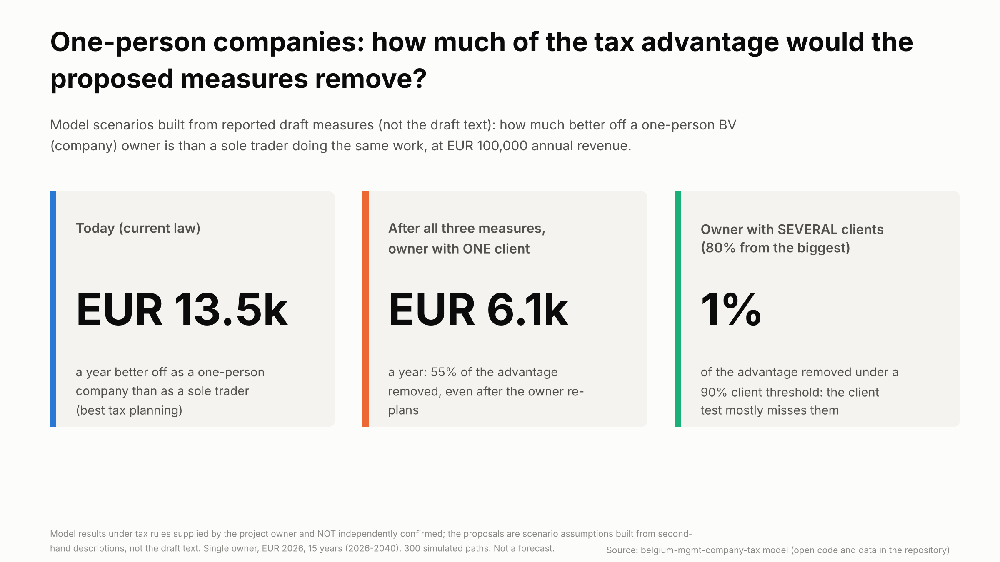
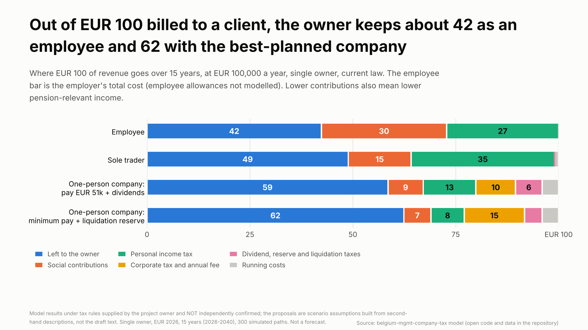
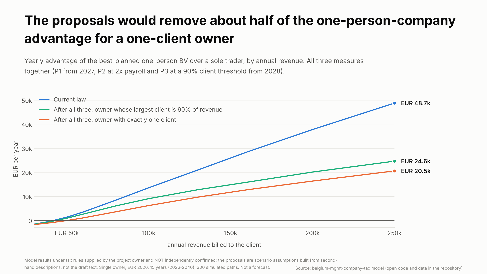
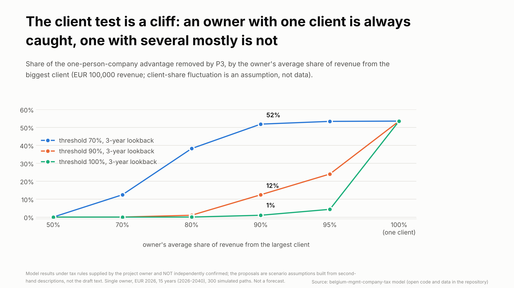

# Will the Belgian draft on management companies reduce entrepreneurs, change the wealth distribution and improve the budget?

**A modelling report on one-person companies (BV/SRL): motivation, method, data and results (15 November 2026).**

> **How to read this report.** Everything below is a *model* result. (1) The tax rules were supplied by the project owner with official citations but **could not be confirmed against the primary pages** (anti-bot blocks and a 404), so every figure is conditional on them; the values to check by hand are in [`hand_check_list.md`](hand_check_list.md). (2) The draft text was not available: P2 (payroll multiple 2x/3x) and P3 (client threshold, lookback) come from second-hand excerpts and are run as **scenario assumptions**, never as 'the proposal'. (3) **No estimate of the number of entrepreneurs, of the wealth distribution or of the budget is made here**; those need a population model and data that are not yet available (section 7). (4) Nothing here is a forecast of what owners will do.

## 1. Summary

- **What the model shows under current law.** A one-person company owner with the best tax planning ends up about **EUR 13,509 a year** better off than a sole trader doing the same work at EUR 100,000 of revenue (14% of revenue), rising to EUR 48,730 at EUR 250,000; below roughly EUR 43k of revenue the company costs more than it saves. 53% of the saving at EUR 100,000 is lower social contributions, which also means lower pension-relevant income. The employee comes out worst: about EUR 6,540 a year behind the sole trader, mostly because the supplied rules put 13.07% + 25% contributions on a wage (employee allowances, work bonus and employer reductions were not supplied and are not modelled, which flatters the company against the employee).
- **Where the advantage comes from.** Mostly from the gap between the exit rate on profits taken out of the company (10% liquidation reserve, 18% VVPRbis, 30% ordinary) and the 45-50% marginal rate on salary. With a 0% return on retained money, holding profit back and taking it out after 3-5 years gives *exactly the same* result as paying the 18% dividend every year: the hypothesis that the benefit is deferral is not what the rules produce; the rate gap is.
- **What the three measures do (scenarios).** *P1* (20% rate needs an employee) only affects owners who pay themselves at least EUR 51,000; hiring is almost never worth it. *P2* (payroll cap) hits lump-sum extraction hardest. *P3* (client test) removes about **53% of the advantage of an owner with a single client** at EUR 100,000 revenue whatever the threshold or lookback, because such an owner is always caught; for owners with several clients the outcome depends on the threshold and is small at a 90% threshold (1% removed for an owner with 80% of revenue from the biggest client). All three together leave a one-client owner at EUR 100,000 with EUR 6,101 a year of advantage instead of EUR 13,509.
- **Timing matters for the budget.** For owners who keep profit in the liquidation reserve, P2 and P3 *reduce* tax revenue in 2028-2039 (the 10% levy is no longer paid) and raise it only when the company is wound up; for owners who pay dividends every year they raise revenue at once. The sign of the early-year effect therefore depends on the mix of owner types, which no public data pin down.
- **What cannot be said yet.** Whether the number of entrepreneurs falls, how wealth is redistributed, and whether EUR 300m (2027) and EUR 450m a year (2028-29) is plausible. Section 7 says what is needed.

## 2. Motivation

**The question.** The federal government's autumn-2026 budget draft (not law as of 15 November 2026; the coalition was still negotiating) proposes to narrow the tax advantages of one-person companies, often called management companies. As reported: (P1) the reduced corporate rate (20% on the first EUR 100,000 of profit) is withdrawn for companies without employees; (P2) the reduced dividend regimes are tied to payroll (the multiple is unknown; 2x and 3x were reported as options; proposed start 1 January 2028); (P3) the reduced dividend regimes (VVPRbis, liquidation reserve) are withdrawn for long-term, single-client, single-director companies for new amounts from 2028. The draft projects EUR 300 million of extra revenue in 2027 and EUR 450 million a year in 2028-2029; the method is unknown.

**The working hypothesis** (project owner): many such companies exist for tax optimisation - pay a minimum salary, retain profits, and take a lump sum out after 3-5 years through VVPRbis or the liquidation reserve at a low rate.

**Why a model.** No Belgian estimate of how many people incorporate in response to tax differences was found, and no public data show how much one-person companies pay themselves, retain, or how concentrated their clients are. A transparent micro-model can still answer three things that need no behavioural assumption: how large the tax advantage is today and for whom; how each measure changes it mechanically; and, as a by-product, how large a behavioural response would have to be to cancel the projected revenue (the break-even, planned for the population stage).

**Segments** (decided by the project owner). *S0* = a BV/SRL with zero employees; *S1* = S0 plus a single director and one client. The three measures touch them differently (P1: S0; P3: S1; P2: depends on payroll). The simulated owner is a single director; client concentration is varied from one client (S1) to half of revenue from the biggest client.

## 3. Methodology

### 3.1 Design in one paragraph

For the *same person doing the same work* the model computes, year by year from 2026 to 2040, what they keep under three arrangements: **employee**, **sole trader** and **one-person BV** (with 19-28 owner strategies). Revenue (for the employee: total employer cost) is identical across arrangements and follows the same random path (paired shocks, 300 simulated paths; a persistent wage shock for all and an extra business shock for the self-employed and the company, sizes taken from the earlier `belgium_abm` model and flagged as assumptions). Each year the household spends a fixed amount; the rest is saved. Outcomes: terminal wealth in 2040 after liquidating the company and paying every tax, total tax and contributions by type, and pension-relevant income. 'Advantage' is the paired difference in terminal wealth against the sole trader (or the employee). A ledger identity - revenue plus interest equals costs, all taxes, spending, change in private wealth and change in company equity - is checked every year for every run (largest residual 1.4e-09).

### 3.2 The tax engine (corrections to the earlier model included)

| rule | as modelled | status |
|---|---|---|
| `pit.brackets` | Personal income tax, brackets 25/40/45/50% (to 16,720 / 29,510 / 51,070) | supplied |
| `pit.reduction_rate` | Tax-free allowance EUR 11,550 applied as a 25% tax reduction (EUR 2,887.50) AFTER the brackets (earlier model deducted it from income first) | supplied |
| `pit.municipal_surcharge` | Municipal surcharge, 7.2% of income tax (national proxy) | supplied |
| `ssc.employee_rate` | Employee contributions 13.07%; employer 25% (comparison on total employer cost) | supplied |
| `se.rate_1` | Self-employed: 20.5% up to EUR 75,024.54, 14.16% to EUR 110,562.42, minimum EUR 890.42 a quarter; base net of the contribution | supplied |
| `corp.standard_rate` | Corporate tax 25%; 20% on the first EUR 100,000 only if director pay is at least EUR 51,000 (or covers taxable profit); first four periods exempt from the pay test (my reading) | supplied |
| `div.ordinary_rate` | Dividends 30%; VVPRbis 18% | supplied |
| `lr.levy_rate` | Liquidation reserve: 10% levy at creation, 3-year lock, then 9.8% withholding (10% + 0.9 x 9.8% = 18.82% in total; owner stated 18%); paid out on liquidation with no further withholding (10% in total); anti-abuse rule (consequence not supplied; default 30%) | supplied |
| `liq.ordinary_rate` | Ordinary liquidation surplus above paid-up capital: 30% | supplied |

Statuses: *supplied* = given by the owner with an official citation, not confirmed by us; *interpretation* = ambiguous wording, my reading flagged; *open* = missing input, default chosen; *assumed* = non-statutory placeholder. **No rule has status 'checked'.** The reserve account is vintaged (each year's allocation keeps its creation year, which the lock and P3 need), and the policy is a path by calendar year so a measure can start in 2027 or 2028.

### 3.3 Owner strategies for the company

A strategy combines a **pay rule** (EUR 51,000 to keep the 20% rate; the smallest pay that covers household spending - 'minimum salary'; fixed higher pay; all profit as salary), a **vehicle** for post-tax profit (dividend every year; retain it; put it in the liquidation reserve) and an **exit** (VVPRbis dividend after 3 or 5 years or at the end; liquidation at 10% via the reserve; ordinary liquidation at 30%). If salary does not cover spending the gap is met by a dividend from retained profit. The 'best' strategy in each cell is the one with the highest mean terminal wealth: an upper bound that assumes perfect knowledge of the rules, not a description of real owners.

### 3.4 Scenarios

| scenario family | definition (all proposal parameters are assumptions) | runs |
|---|---|---|
| **Baseline** | current law as supplied | 1 |
| **P1** from 2027 (and 2028) | the 20% rate on the first EUR 100,000 requires a paid employee; the owner may hire at an annual employer cost of EUR 5,000 / 10,000 / 20,000 (EUR 1 as a diagnostic) from the start year; the hire is a pure cost | 2 x 5 |
| **P2** at 2x and 3x, from 2028 (and 2027) | each year the reduced regimes (VVPRbis dividends, liquidation-reserve allocations and dividends) are limited to payroll / m, payroll = director pay + any employee's wage in the same year; excess dividends 30%, excess allocations stay in the free reserve; applies to old reserves | 4 |
| **P3** from 2028 | in a year when the owner's largest-client share was at least the threshold (70, 80, 90 or 100%) in every year of the lookback (3 or 5 years), that year's post-tax profit cannot use VVPRbis or the liquidation reserve; earlier amounts are grandfathered | 8 settings x 5-6 owner concentrations |
| **Combined** | P1 (2027) + P2 (2x or 3x) + P3 (five threshold/lookback settings) from 2028, owners may also raise pay and hire | 10 settings x 2-3 concentrations x 2-3 hire options |
| **Sensitivities** (comparison A) | return on retained funds 2-3%; liquidation-reserve total 18%; lock one year longer; no exemption in the first four periods; 14.16% above the second ceiling; a hypothetical EUR 3,000 employee deduction; anti-abuse rule off | 9 |

In total 25 proposal scenarios, 101 distinct runs x 3 household types = 303 simulations in comparison B (redundant runs were dropped: for an owner with exactly one client every P3 and combined setting gives the same result, which a test proves, so it is run once per family and copied). Household types: single; couple with one earner and two children; couple with two earners and two children (they differ only in how much the owner must draw, because taxation is individual and family tax rules were not supplied). Revenue levels: EUR 30,000 to 250,000 a year. Company age: already in its fifth taxable period in 2026 ('mature'), so the EUR 51,000 test applies from year one.

Two views of how an owner responds are reported: **static** (keep the strategy that was best under current law; no hire) and **re-optimised** (best of 28 strategies, including higher pay, and the best hire choice). Neither includes entry or exit of companies, relocation, or changes of client.

### 3.5 Verification

65 automated tests: hand-computed worked examples for every tax function and for whole one-year cases of each arrangement and each proposal (arithmetic in `worked_examples.md`); invariants (the ledger reconciles under every proposal and combination, a proposal can only hurt a fixed strategy, tighter parameters hurt more, the employee and sole trader are untouched, a no-change policy path equals the baseline, a company that pays out all profit equals a sole trader with the same costs). These tests check the code against the *supplied* rules; no official published example was available, so they do not confirm the rules. The pruned and parallelised comparison B reproduces the earlier full grid exactly (12,120 shared rows, maximum difference 0).

## 4. Data taken

No new web data were collected for these runs; inputs are the owner's supplied rules, official statistics found in earlier sessions, and stylised assumptions. Full registry: `data/sources.yaml`, `docs/rules_inputs.md`, `docs/evidence_found.md`.

| input | value / use | source | status |
|---|---|---|---|
| Personal income tax, contributions, corporate and dividend rules | see 3.2 | project owner, citing fin.belgium.be, ONSS/RSZ, INASTI/RSVZ, law of 30 May 2026 | **supplied, not confirmed** (primary pages blocked or 404) |
| Draft measures P1 | 20% -> 25% on the first EUR 100,000 for companies without employees | project owner (budget draft) | supplied; employee test unknown |
| Draft measures P2 (2x/3x) and P3 (90%, lookback) | scenario grids | Reddit reposts of a draft excerpt and press reports | **scenario assumptions, low-quality source** |
| Government revenue projection | EUR 300m (2027), EUR 450m a year (2028-29) | project owner | supplied; method unknown; used only as a plausibility reference |
| VAT-registered enterprises with no employees, end 2024 | 997,481 (context, not used in the runs) | Statbel BeStat | checked |
| BV/SRL, all sizes, 2024 | 477,126 (context) | Statbel BeStat | checked |
| BV/SRL SMEs and share without employees | 476,914 and 73.7%, i.e. about 351,000 (context and plausibility arithmetic) | FPS Economy via project owner | supplied, share unverified |
| Zero-employee enterprises, births, deaths (2024) | 729,925; 67,369; 50,325 (context) | Eurostat | checked (different definition) |
| Shock sizes, running costs, paid-up capital | wage shock sd 0.08 / persistence 0.9; business shock sd 0.25 / 0.6; EUR 1,000 and 4,000 a year; EUR 12,000 | stylised assumptions of the earlier `belgium_abm` model | assumed |
| Household spending needs, partner income | EUR 24,000 + 12,000 partner + 6,000 per child; partner nets EUR 30,000 | placeholders | assumed |
| Client concentration of owners | mean largest-client share 50-100% with assumed fluctuation | none exists | **not data** |
| Distribution of director pay and retained profits in S0; share of S0 with one client | - | not found (candidate: form 281.20, NBB annual accounts) | **missing** |

Not used and not found: a Belgian estimate of the incorporation elasticity (international studies exist and are listed in `evidence_found.md`, none read in full), tax-return microdata, and the draft text itself.

## 5. Results

### 5.1 Current law: how large is the advantage, and where does it come from?

| revenue a year | best company strategy | company vs sole trader, EUR a year | % of revenue | company vs employee, EUR a year | sole trader vs employee, EUR a year |
|---|---|---|---|---|---|
| 40,000 | min_lr_liq | -438 | -1% | 1,789 | 2,227 |
| 60,000 | min_lr_liq | 3,417 | 6% | 6,866 | 3,448 |
| 100,000 | min_lr_liq | 13,509 | 14% | 20,048 | 6,540 |
| 160,000 | thr_lr_liq | 28,385 | 18% | 41,688 | 13,303 |
| 250,000 | thr_lr_liq | 48,730 | 19% | 74,192 | 25,462 |

At EUR 100,000 the best company saves EUR 247,630 in tax and contributions over 15 years compared with the sole trader, of which EUR 130,166 (53%) is lower social contributions and EUR 117,464 lower taxes; the company's contributions are lower because director pay is lower than profit, and so is pension-relevant income (EUR 32,047 a year against EUR 83,752 for the sole trader). No euro value is put on pensions.

**Sensitivities (EUR over 15 years at EUR 100,000 revenue, best company vs sole trader, baseline 202,630).** A 2% real return on retained funds raises it to 219,796 and 3% to 228,932; if the 2026 anti-abuse rule applies to a liquidation-reserve payout (payout taxed at 30%, rate assumed) the reserve route falls from 202,630 to 29,574; without the reduced VVPRbis rate (30% dividends) the 'pay EUR 51k, dividends' route gives 79,865 instead of 144,753. Details and the open inputs behind each case: `comparison_A_results.md`.

### 5.2 The three measures, one at a time and together

**P1.** The extra corporate tax falls only on owners who pay themselves EUR 51,000 or more. Owners following the 'minimum salary' strategy, which is best under current law up to about EUR 130,000 of revenue, never had the 20% rate and are unaffected. At EUR 160,000 an owner who kept the EUR 51,000 strategy loses EUR 3,304 a year, and by switching to minimum pay loses only EUR 535. A hire pays for itself only if it costs less than about EUR 1-2 thousand a year for a single owner (the one-earner household at EUR 160,000+ is the exception, where a EUR 5,000 hire sometimes wins), so the avoidance margin is mostly a change of strategy, not a hire.

**P2.** At 2x the advantage at EUR 100,000 falls by 26% (re-optimised) and at 3x by 34%; the effect grows with revenue (45% / 48% at EUR 250,000). It hits 'retain, then take a lump sum' hardest, because a lump exceeds the yearly capacity of payroll / m, and an owner can partly offset it by paying a higher salary at 45-50% marginal tax.

**P3.** For an owner with exactly one client P3 binds every year, so the result does not depend on the threshold or lookback.

Share of the advantage removed by P3 (EUR 100,000 revenue, single owner, re-optimised), by the owner's mean share of revenue from the biggest client:

| threshold, lookback | 100% (one client) | 95% | 90% | 80% | 70% |
|---|---|---|---|---|---|
| 70%, 3y | 53% | 53% | 52% | 38% | 12% |
| 90%, 3y | 53% | 24% | 12% | 1% | 0% |
| 90%, 5y | 53% | 16% | 6% | 0% | 0% |
| 100%, 3y | 53% | 4% | 1% | 0% | 0% |

**Combined.** For a one-client owner at EUR 100,000 the advantage falls from EUR 13,509 to EUR 6,101 a year (55% removed); the break-even revenue below which the company is worse than a sole trader rises from EUR 42,561 to EUR 51,306. For an owner with 90% of revenue from one client, the combined scenarios remove between 31% and 54% depending on the P2 multiple and the P3 threshold - the parameters that are least known are the ones that matter for owners who are not strictly single-client. Tables by revenue, household and scenario: `comparison_B_results.md`.

### 5.3 Timing: who pays when

Per owner and year, under all three measures with static behaviour at EUR 100,000 revenue and one client: an owner paying EUR 51,000 plus annual dividends pays about EUR 5,801 more in 2028-29; an owner on the liquidation reserve with EUR 51,000 pay pays EUR 1,492 *less*, and one on minimum pay EUR 4,267 less; the reserve owners' extra tax then arrives in the liquidation year (2040: +130,730 and +162,142). The 2040 figure is partly an artefact of a fixed 15-year horizon; in a population companies close at different times. For P1 alone in 2027 the owners who pay EUR 51,000 or more pay about EUR 1,726-1,895 more a year and the others nothing. Illustrative arithmetic only: raising EUR 300 million in 2027 from P1 alone would need about 173,793 owners of the first archetype, against about 351,000 zero-employee BV/SRL SMEs (share unverified); raising EUR 450 million a year in 2028-29 from the combined measures would need about 77,568 annual-dividend owners at this revenue level; owners using the reserve contribute less, not more, in those years. The real population is a mixture of owner types that is not known, so this is a scale check, not a validation of the draft's figure.

## 6. What this means for the three questions

| question | what the model supports | what it does not support |
|---|---|---|
| Fewer entrepreneurs? | Under current law the company beats a sole trader only above about EUR 43k of revenue and gains most at high revenue; the measures cut that gain by roughly half for a one-client owner and raise the break-even revenue to about EUR 51k. Whether anyone leaves depends on how responsive the choice of arrangement is. | A count. No Belgian elasticity exists in what was found; the number can only be given as a function of an assumed sensitivity, with the break-even sensitivity (planned). |
| Wealth distribution? | For owner-manager households the measures lower the tax-sheltered wealth they can build (the loss columns). | A national distribution result: needs the population model and the bounding 'no management companies' scenario; the national tail is not identified by public data. |
| Budget? | Mechanically, who pays more and when (5.3), including that some owner types pay *less* early on. | Whether EUR 300m / 450m is reached: needs the number of owners of each type, which is unknown, and behavioural responses. |

## 7. Limitations and what is needed next

- **Rules unconfirmed.** Please confirm the values in [`hand_check_list.md`](hand_check_list.md); the most consequential are: the liquidation-reserve total (18.82% from the components vs 18% stated), my reading of 'test starts in the fifth taxable period', the lock counting, a possible dividend-vs-paid-up-capital condition on the 20% rate (not modelled; the engine refuses to run if it is switched on), VVPRbis eligibility, and the contribution base above the second ceiling.
- **Proposals are second-hand.** P2 and P3 mechanics are my choices; the draft text should replace them.
- **Perfect-foresight owners.** The 'best' company strategy is an upper bound; comparators get no tax-advantaged pension saving and the employee no allowances, which overstates the company's edge.
- **Owner mix unknown.** The distribution of pay, retained profits and client concentration in S0 and S1 drives the budget more than any parameter; no public count of S1 was found (the 'more than 80,000 single-person management companies' claim is unverified and defined differently).
- **Not modelled:** entry and exit, relocation, incidence on clients, general equilibrium, a client-diversification response to P3, family tax rules, indexation, the taxes on a hire's wage, pension values.
- **Constant 2026 euros, 15-year horizon with liquidation in 2040** (an artefact for late-year effects).
- Full list: `limitations.md`.

**Next steps** (need the project owner's go-ahead): (1) confirm the hand-check list and supply the draft text; (2) supply or find the open inputs - director pay and retained profits in S0, the share of S0 with one client and with a single director; (3) WP3-4: choice of arrangement with a swept sensitivity, a population of owners, the 'no management companies' bounding case and the break-even sensitivity against EUR 450 million.

## 8. Figures for sharing, with suggested captions

All figures are in `docs/figures/` (PNG, 2400 x 1350, 16:9, light background; the values behind each are in `docs/figures/figure_data.csv`). Each image carries its own caveat footer. **Before posting:** the numbers rest on rules that have not been confirmed against primary sources and on scenario assumptions for the proposals; confirm the hand-check list first, and keep the caveat in the post, because a screenshot travels without this report.

**01_headline.png** - Model of Belgian one-person companies (BV): at EUR 100k revenue the best-planned company beats a sole trader by about EUR 13.5k a year today. Under scenarios built from the reported draft, a one-client owner keeps about EUR 6k of that; an owner with several clients is barely touched by the client test. Model result on unconfirmed rules, not a forecast.

**02_advantage_by_revenue.png** - The company advantage grows with revenue (EUR 49k a year at EUR 250k). In the model the three measures together cut it by about half for an owner with one client; below ~EUR 43-51k revenue the company costs more than it saves. Scenario results, not the draft.

**03_where_100_euro_goes.png** - Out of EUR 100 billed: ~42 left to an employee, ~49 to a sole trader, ~59-62 to a one-person company in the model. Part of the gap is lower social contributions, i.e. lower pension-relevant income. Rules as supplied, unconfirmed.

**04_advantage_by_exit_route.png** - Why the company wins in the model: the exit rate on profit (10% reserve, 18% VVPRbis) versus 45-50% marginal tax on salary. Holding profit back and taking it later adds nothing at 0% return; the rate gap does.

**05_who_is_hit.png** - Who loses under each measure depends on how the owner pays out profit: P1 only hits owners paying EUR 51k+; P2 hits lump sums; P3 hits one-client owners using VVPRbis or the liquidation reserve. Per-owner loss, same planning, model scenarios.

**06_client_test_cliff.png** - A client-concentration test is a cliff in the model: an owner with exactly one client is always caught; one with 80% from the biggest client mostly is not at a 90% threshold. How many owners sit where is unknown. Scenario assumption, not the draft.

**07_timing.png** - Same reform, opposite sign for revenue in the first years in the model: owners paying annual dividends pay more at once; owners using the liquidation reserve stop paying its 10% levy and are taxed only at liquidation. The mix of owner types decides the budget profile.

## 9. Where everything is

| file | content |
|---|---|
| `docs/report.md` | this report |
| `docs/comparison_A_results.md`, `docs/comparison_B_results.md` | detailed result tables |
| `docs/rules_inputs.md`, `docs/hand_check_list.md` | rules, statuses, readings, what to confirm |
| `docs/worked_examples.md`, `docs/implementation_design.md` | hand-computed examples; how the engine is built |
| `docs/limitations.md`, `docs/data_requirements.md`, `docs/evidence_found.md` | limits, data needs, evidence found |
| `configs/` | policy, assumptions and proposal switches (one entry per rule with status and source) |
| `outputs/` | all result tables and manifests |
| `scripts/` | `run_comparison_a.py`, `run_comparison_b.py` (about 2 minutes), `make_report_*.py`, `make_figures.py` |

Reproduce: `pip install -e <belgium_abm>; pip install numpy pandas pyyaml pytest matplotlib; pytest; python scripts/run_comparison_a.py; python scripts/run_comparison_b.py; python scripts/make_report_a.py; python scripts/make_report_b.py; python scripts/make_figures.py; python scripts/make_report_main.py`.
